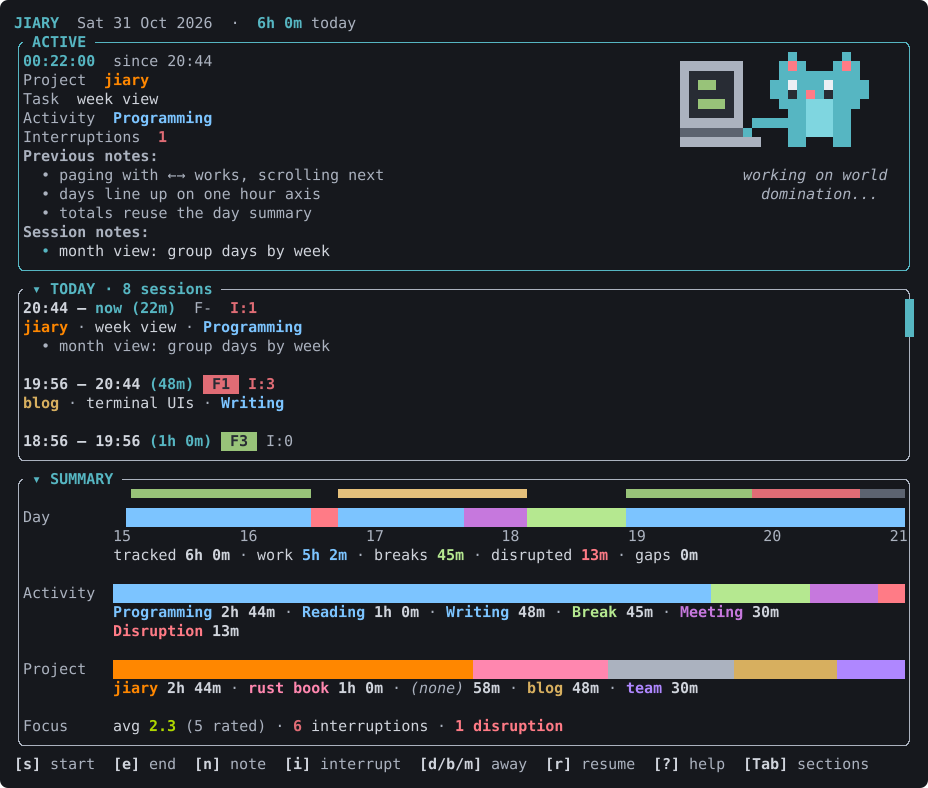

# Jiary



A work diary for the terminal. Jiary keeps a record of your working day as
it happens: what you worked on, for how long, how focused you were, and what
got in the way. Recording takes a key or two, so you can keep your mind on
the work.

**It is** a local-first diary. Your days are kept in one SQLite file on your
computer, with summaries of each day, week, month and year.

**It is not** a task manager, a planner or a habit tracker. There are no
to-do lists, priorities, goals or reminders. It records what happened and
doesn't tell you what to do next. It has no accounts and no sync, and it
never touches the network.

## Install

On macOS or Linux (x86_64 or ARM):

```sh
curl -fsSL https://raw.githubusercontent.com/barcanjocs/jiary/main/install.sh | sh
```

This downloads the latest release for your system, checks it against its
published checksum, and puts `jiary` in `~/.local/bin` (set
`JIARY_INSTALL_DIR` to put it elsewhere). Run it again to update.

With a Rust toolchain, you can build it from source instead:

```sh
cargo install --git https://github.com/barcanjocs/jiary
```

## Getting started

Run `jiary` in a terminal. Your diary is created on first run.

A typical day:

1. **`s` to start a session.** Type an activity (Programming, Reading, …),
   then optionally a project and a task. Suggestions come from what you've
   used before: `Tab` picks one, `Enter` moves on. Next time, the form lists
   your recent combinations, so `1`–`5` starts one in a single key.
2. **`n` to add a note**, and **`i` to count an interruption** (a phone
   glance, a chat ping) while you work.
3. **`d`, `b` or `m` when something else comes up**: a disruption, a break
   or a meeting. **`r` resumes** the work you left.
4. **`e` to end the session.** Then, within 5 seconds, press `1`, `2` or `3`
   to rate your focus (bad, ok or good), or just carry on.
5. **`u` undoes** the last start or end if you got it wrong.

The main screen shows the running session, today's sessions and a summary of
the day. Press `/` for the command palette, where `/weekly`, `/monthly` and
`/yearly` look back further. Press `?` for every key, and `q` to quit.

## More

- **[User manual](docs/user/README.md)**: every workflow in detail, all the
  keys, and where your data lives (and how to back it up).
- **[Developer manual](docs/dev/README.md)**: building, checking, releasing,
  and how Jiary works inside.

## Why I made this

I wanted a Pomodoro-style timer with more flexibility and less friction.
I like starting a work session with a Pomodoro in mind, but I don't want to
be interrupted after 25 minutes: if I'm in deep flow, I want to keep going
until I get tired, then glance at the clock and check I've put in the time
before taking a break. So Jiary never alerts you. The timer just counts up,
and the cat starts dozing off once you've been at it for 25 minutes.

I also wanted starting a session, and getting through a busy day of
interruptions, breaks and meetings, to take a key or two rather than a
form. And I wanted to see how my focus and my time add up across days,
weeks and months.
