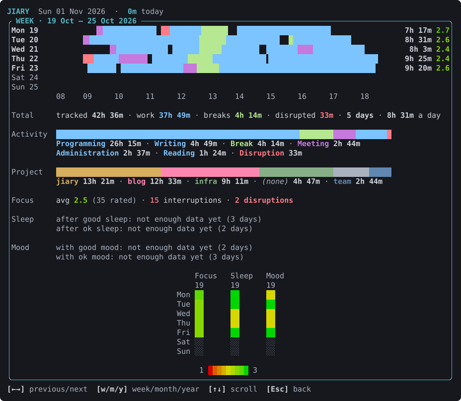
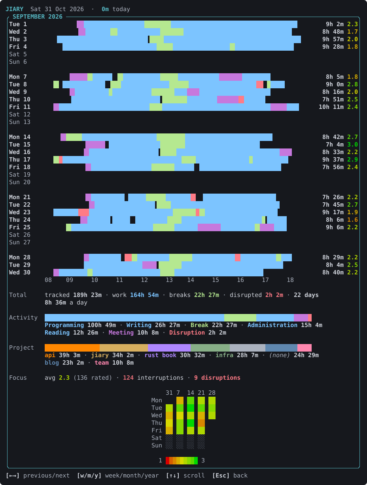
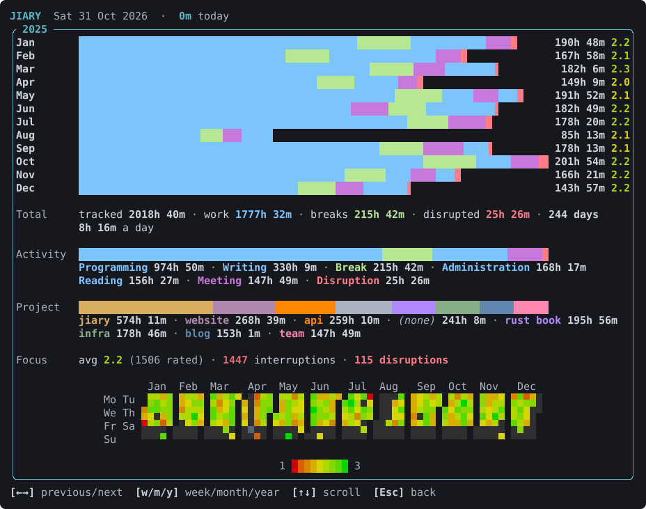

# Looking back

## The command palette

Press `/` to open the command palette. It lists every action by name, with
what it does and its key.

- Type to filter. Matching is fuzzy, so `/und` finds `undo`.
- `↑`/`↓` pick a command, `Tab` completes its name, and `Enter` runs it.
- `Esc` (or Backspace past the `/`) closes the palette.

A command does exactly what its key does, so the palette is also a way to
learn the keys. It's also how you open the longer views, which have no key
of their own.

## Weeks and months

`/weekly` shows the current calendar week (Monday to Sunday) and `/monthly`
the current month, a row per day. Each row is the day's timeline in activity
colors, on an hour axis that all the days share so they line up, followed by
the day's tracked time and average focus. A month is grouped by week and
scrolls.

Under the days come the period's totals, like today's summary:

- tracked time, split into work, breaks and disruptions;
- the days you tracked, and the average per day;
- the activity and project bars;
- focus.

Focus also shows as a grid of squares: a row per weekday, a column per week.
Each day is colored on a gradient from red (1) through yellow to green (3)
by its average focus. Days you tracked without rating show dark gray, and
days with nothing tracked show a faint texture.

## Years

`/yearly` shows the whole year, laid out like the other views:

1. a row per month, with its activity bar (scaled to your busiest month),
   its tracked time and its focus;
2. the year's totals;
3. its focus grid, compact enough for 53 weeks (each day is half a row tall,
   two to a character), with the month names over it.

## Keys in these views

| Key | Action |
|-----|--------|
| `←` `→` / `h` `l` | The week, month or year before / after (never into the future) |
| `w` `m` `y` | Switch to this week, month or year |
| `↑` `↓` / `j` `k`, `PgUp` `PgDn`, `Home` `End` | Scroll |
| `Esc` / `q` | Back to the main screen |
